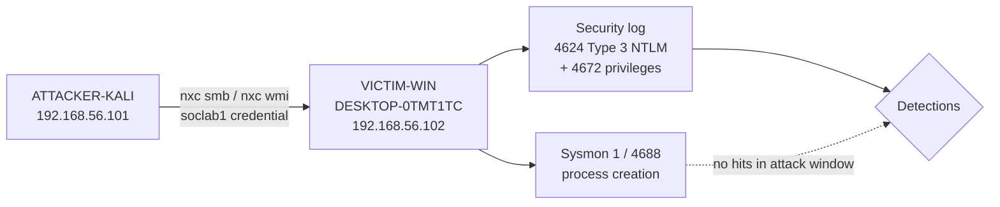
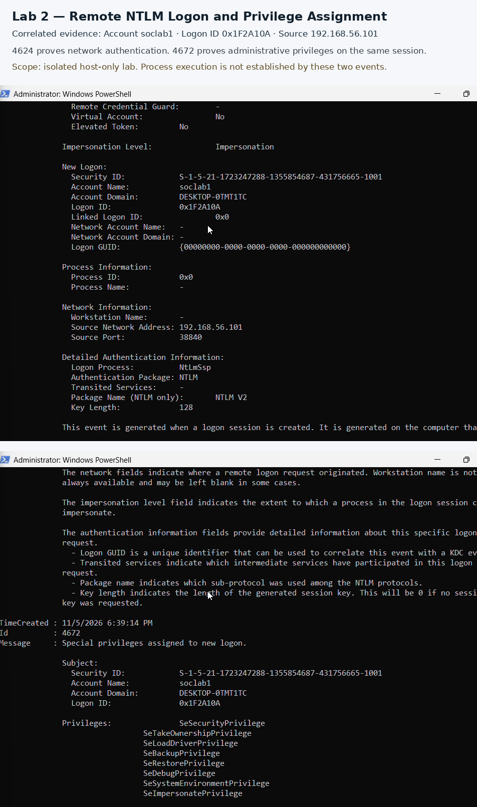

# SOC Lab 2: Detecting Remote NTLM Access and Administrative Privilege Assignment

## TL;DR

- **What:** Reused a sprayed local administrator credential (`soclab1`) from Kali to authenticate to a Windows host over SMB and WMI (**T1078** Valid Accounts). SMB service authentication only for **T1021.002**; WMI (**T1047**) as an attempted remote channel—not proven execution.
- **Detected by:** Security **4624** (Logon Type 3, NTLM) correlated by Logon ID with **4672** (administrative privileges assigned).
- **Finding:** Remote authentication and admin privilege assignment are proven. Process execution is not established.

## Scenario and Scope

An attacker who already holds a valid local administrator password (Lab 1 spray) authenticates from another host on the same isolated network. This lab documents what Windows Security telemetry records for that reuse, and how to correlate authentication with privilege assignment.

## Lab Environment

| Host | Role | IP |
|---|---|---|
| ATTACKER-KALI | Network attacker (NetExec / Impacket) | 192.168.56.101 |
| VICTIM-WIN (DESKTOP-0TMT1TC) | Target, Windows 11 / Server 2025 Build 26100 | 192.168.56.102 |

- VirtualBox host-only network, isolated (no internet)
- Telemetry: Security log (4624, 4672; targeted 4688), Sysmon process creation (Event 1)
- Accounts/passwords in this repo are throwaway lab credentials only



## Attack: Valid-Account Reuse over SMB and WMI

**MITRE mapping (precise):**
| Technique | Observation in this lab |
|---|---|
| T1078 Valid Accounts | Observed — successful remote NTLM logons as `soclab1` |
| T1021.002 SMB/Windows Admin Shares | SMB service authentication only (`nxc smb`); no share enumeration or file operations claimed |
| T1047 Windows Management Instrumentation | Attempted channel (`nxc wmi`, `impacket-wmiexec`); authentication to port 135 observed; command execution not proven |

**Commands run (Kali)** — password redacted; throwaway lab credential from Lab 1:
```bash
nxc smb 192.168.56.102 -u soclab1 -p '<lab-password>'
nxc wmi 192.168.56.102 -u soclab1 -p '<lab-password>' -x 'whoami && hostname'
impacket-wmiexec 'soclab1:<lab-password>@192.168.56.102' 'whoami'
```

**Attacker-side observation:** NetExec confirmed `DESKTOP-0TMT1TC\soclab1` authenticated over WMI (TCP 135). No `whoami`/`hostname` output and no NetExec `Pwn3d!` marker were available. Endpoint **4672** still shows the resulting sessions received administrative privileges—tool banner and Windows privilege assignment are separate facts.

## Detection

### Finding

Between **6:39:14 PM** and **6:45:06 PM** local VM time on Nov 5, 2026, `soclab1` completed many Type 3 NTLM logons from `192.168.56.101`. Matching **4672** events assigned admin privileges on the same Logon IDs. One strong pair: Logon ID `0x1F2A10A` at 6:39:14 PM (source port 38840). Repeated NetExec connections create many sessions—count distinct Logon IDs, not raw event volume.

An **ANONYMOUS LOGON** 4624 Type 3 at 6:39:14 PM (port 38824, NTLM V1) is normal SMB null-session setup, not a compromised account.

### Evidence

| Field | 4624 / 4672 correlation example |
|---|---|
| Time | 6:39:14 PM local VM time |
| Account | `soclab1` (`DESKTOP-0TMT1TC`) |
| Logon ID | `0x1F2A10A` (shared) |
| Source | `192.168.56.101:38840` |
| Auth | NtLmSsp / NTLM / NTLM V2 |
| 4672 privileges | `SeSecurityPrivilege`, `SeTakeOwnershipPrivilege`, `SeLoadDriverPrivilege`, `SeBackupPrivilege`, `SeRestorePrivilege`, `SeDebugPrivilege`, `SeSystemEnvironmentPrivilege`, `SeImpersonatePrivilege`, `SeDelegateSessionUserImpersonatePrivilege` |



### Interpretation

- **4624** proves network authentication with a valid account from Kali.
- **4672** on the same Logon ID proves that session received administrative privileges—even though NetExec did not print `Pwn3d!`.
- Targeted **4688** (18:38–18:46, `whoami`/`hostname`/`cmd.exe`) returned nothing. A Sysmon Event 1 query with `MaxEvents 100` only surfaced older `WmiPrvSE` starts (latest Nov 3); the attack-window Sysmon query also returned nothing. Those absences mean the queries did not find execution—they are **not** proof that nothing executed.

### Hunt queries

Use **New Logon** fields via Properties indices (Lab 1 style). A first-match on `Account Name` / `Logon ID` in the Message text hits the Subject (`-` / `0x0`), not the New Logon.

```powershell
# Remote NTLM Type 3 logons (non-machine, non-anonymous)
Get-WinEvent -FilterHashtable @{LogName='Security'; Id=4624; StartTime=(Get-Date).AddMinutes(-30)} |
  Where-Object {
    $_.Properties[8].Value -eq 3 -and
    $_.Properties[10].Value -match 'NTLM' -and
    $_.Properties[5].Value -notlike '*$' -and
    $_.Properties[5].Value -ne 'ANONYMOUS LOGON'
  } |
  ForEach-Object {
    [PSCustomObject]@{
      Time       = $_.TimeCreated
      Account    = $_.Properties[5].Value   # New Logon TargetUserName
      LogonId    = $_.Properties[7].Value   # New Logon TargetLogonId
      SourceIP   = $_.Properties[18].Value
      SourcePort = $_.Properties[19].Value
      AuthPkg    = $_.Properties[10].Value
    }
  } |
  Format-Table -AutoSize
```

```powershell
# Correlate 4624 -> 4672 by New Logon Logon ID (lab window)
$start = Get-Date '2026-11-05 18:38:00'
$end   = Get-Date '2026-11-05 18:46:00'

$logons = Get-WinEvent -FilterHashtable @{LogName='Security'; Id=4624; StartTime=$start; EndTime=$end} |
  Where-Object {
    $_.Properties[8].Value -eq 3 -and
    $_.Properties[5].Value -eq 'soclab1' -and
    $_.Properties[18].Value -eq '192.168.56.101'
  }

foreach ($e in $logons) {
  $lid = $e.Properties[7].Value
  $priv = Get-WinEvent -FilterHashtable @{LogName='Security'; Id=4672; StartTime=$start; EndTime=$end} |
    Where-Object { $_.Properties[3].Value -eq $lid } |
    Select-Object -First 1
  [PSCustomObject]@{
    Time4624 = $e.TimeCreated
    LogonId  = $lid
    Has4672  = [bool]$priv
    PrivTime = if ($priv) { $priv.TimeCreated } else { $null }
  }
}
```

Full hunts (including process-creation checks and distinct-LogonId summary): [`detections/hunt-queries.ps1`](detections/hunt-queries.ps1)

Sigma (4624 authentication only; 4672 join belongs in the hunt/SIEM): [`detections/sigma/remote-ntlm-admin-logon.yml`](detections/sigma/remote-ntlm-admin-logon.yml)

## Key Findings

1. **Valid-account reuse is high signal.** Unexpected Type 3 NTLM success for a privileged local account from another host warrants investigation even without a shell.
2. **Join 4624 to 4672 on Logon ID.** That join is what proves administrative privilege assignment for the same session (`0x1F2A10A` in the example).
3. **Tool noise ≠ multiple compromises.** NetExec opens many short-lived sessions; alert on account + source + distinct Logon IDs.
4. **Authentication ≠ execution.** Empty 4688 / Sysmon attack-window queries leave execution unproven; they do not disprove it.
5. **Filter SMB null sessions.** `ANONYMOUS LOGON` Type 3 alongside the real account is expected setup traffic.

## Recommended Alerts

| Alert | Data source | Logic |
|---|---|---|
| Remote NTLM network logon (non-machine) | Security 4624 | Logon Type 3, Authentication Package NTLM, TargetUserName not `*$` and not `ANONYMOUS LOGON`. Raise severity when source IP is outside approved jump hosts. |
| Privileged remote logon | Security 4624 + 4672 | SIEM/hunt join on Logon ID; 4672 includes high-impact privileges (`SeDebugPrivilege`, `SeBackupPrivilege`, `SeRestorePrivilege`, `SeTakeOwnershipPrivilege`, …). |
| Burst of remote admin sessions | Security 4624 | Same account + source IP with many distinct Logon IDs in a few minutes (tooling pattern). |

## Limitations

- Process execution not established (no reliable remote command output; attack-window 4688/Sysmon queries empty—absence is not proof of non-execution).
- `impacket-wmiexec` produced no reliable output to document.
- Single host, PowerShell hunting only; Sigma untested against a SIEM.
- Build string from local output: Windows 11 / Server 2025 Build 26100.

## Next Steps / Remediation

1. Forward Security logs to a SIEM and implement the 4624→4672 Logon ID join.
2. Harden, then retest expecting failure:
   - Set a strong unique password for `soclab1` (or remove the account).
   - Remove unnecessary local administrator rights.
   - Restrict remote WMI/DCOM to approved management hosts.
   - Retest `nxc smb` / `nxc wmi` from Kali; confirm auth fails or is blocked.
3. Only chain a later “remote execution” lab when process-creation telemetry or reliable remote output supports it.

## Repository Layout

```
README.md
detections/
  hunt-queries.ps1
  sigma/
    remote-ntlm-admin-logon.yml
evidence/
  lab2-correlated-4624-4672.png
  README.md
```

## Cleanup

Lab-only host. After the exercise:

```powershell
# Replace CHANGE_ME with a new strong unique password, or delete the lab account
net user soclab1 CHANGE_ME
# net user soclab1 /delete

Get-SmbShare
Get-NetFirewallRule -DisplayGroup 'Windows Management Instrumentation (WMI)' |
  Select-Object DisplayName, Enabled, Direction, Action
```
